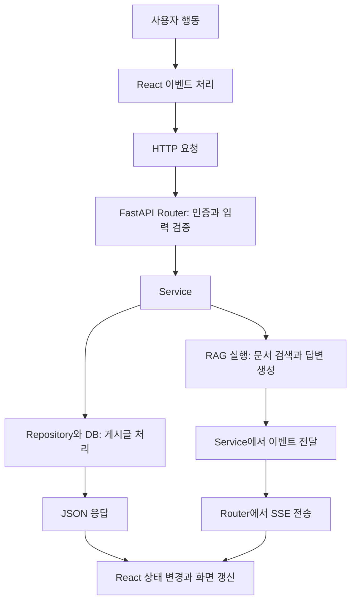
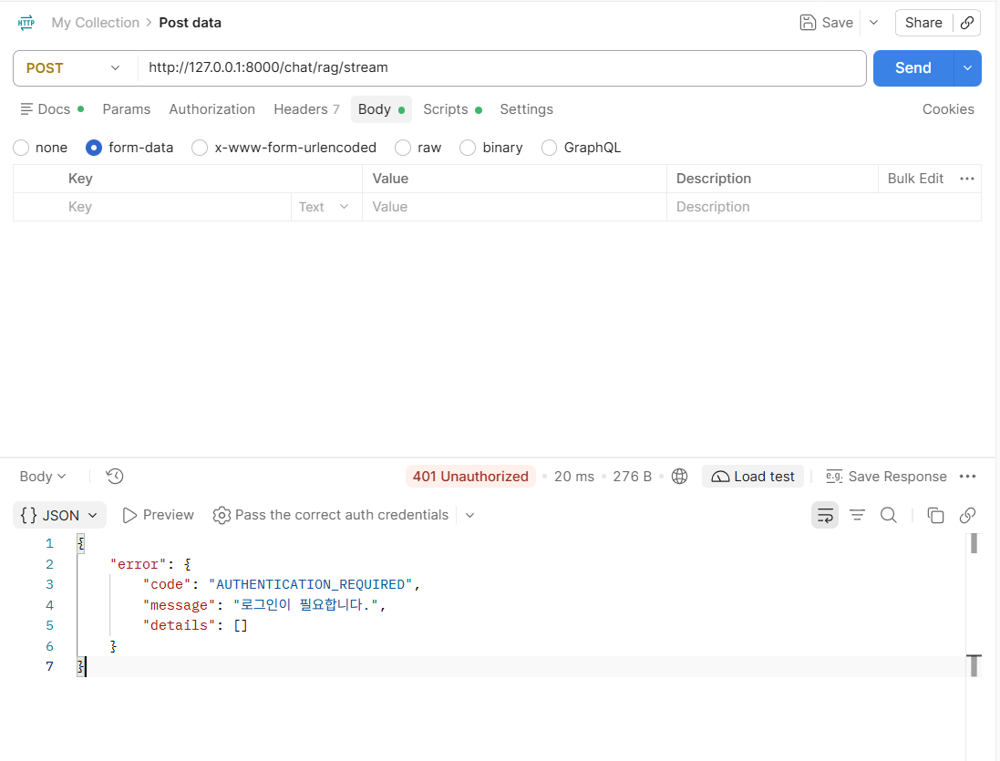
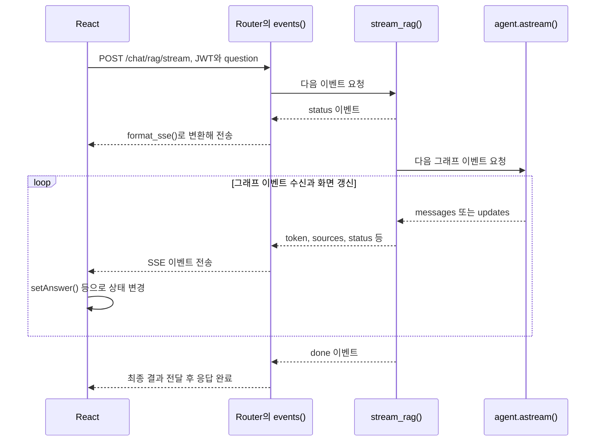

# 26.10.29 TIL(FastAPI · React · JWT 인증 · 비동기와 SSE)

## [TIL] React의 요청이 FastAPI를 거쳐 화면으로 돌아오기까지

오늘은 **React와 FastAPI의 연결**, **JWT 인증**, **제너레이터와 비동기**, **SSE 스트리밍**을 정리했다. 개념만 따로 외우기보다 실제 게시글 작성과 RAG 질문이 처리되는 과정에 연결했다.

이 글은 공부하면서 남긴 메모와 이번 대화에서 확인한 코드·오류 기록을 바탕으로 작성했다. 로그인과 RAG 요청은 사용 방법을 정리한 것이며, Postman 로그인 성공이나 RAG 답변 완료까지 검증했다는 뜻은 아니다.

**목차**

1. [프론트엔드와 백엔드 연결](#1-프론트엔드와-백엔드는-어떻게-연결될까)
2. [CORS](#2-cors는-무엇을-허용할까)
3. [useState와 useEffect](#3-react의-usestate와-useeffect)
4. [JWT와 Postman 로그인](#4-로그인-토큰과-postman-인증)
5. [게시글 작성과 계층별 역할](#5-게시글-작성은-어느-계층을-거칠까)
6. [제너레이터와 yield](#6-제너레이터와-yield-값을-내보내고-이어서-실행하기)
7. [async·await·async for](#7-async--await--async-for와-비동기)
8. [SSE와 중첩된 스트림 전달](#8-sse와-제너레이터-안의-제너레이터)
9. [app.state와 lifespan](#9-appstate와-lifespan은-왜-필요할까)
10. [비동기 ORM과 lazy loading](#10-비동기-orm에서-lazy-loading을-조심하는-이유)
11. [실제 실행 오류와 검증 결과](#11-실제-실행-오류와-확인-결과)
12. [헷갈린 점 다시 정리](#12-헷갈린-점)



```text
사용자 행동
→ React 이벤트 처리
→ HTTP 요청
→ Router의 인증·입력 검증
→ Service
→ 게시글은 Repository·DB / 질문은 RAG 실행
→ JSON 응답 또는 SSE 이벤트 전송
→ React 상태 변경
→ 화면 갱신
```

---

## 1. 프론트엔드와 백엔드는 어떻게 연결될까?

### 1-1. API 호출은 정해진 형식으로 요청하는 일

**프론트엔드(Frontend, FE)**는 화면과 사용자 입력을 처리하고, **백엔드(Backend, BE)**는 인증·업무 처리·DB 접근을 담당한다. API 호출은 FE가 BE의 정해진 주소에 요청을 보내는 것이다.

“데이터 좀 줘”뿐 아니라 “이 게시글을 저장해 줘”, “이 질문에 답해 줘”도 API 요청이다.

| 요청 요소 | 역할 | 프로젝트 예시 |
|---|---|---|
| URL | 요청할 기능의 주소 | `http://127.0.0.1:8000/posts` |
| HTTP 메서드 | 수행할 동작 | 조회는 `GET`, 생성은 `POST` |
| Header | 인증 정보·본문 형식 등 | `Authorization`, `Content-Type` |
| Body | 서버에 전달할 입력 | 제목·내용 또는 질문을 담은 JSON |
| Response | 서버의 처리 결과 | 상태 코드와 JSON 또는 SSE 이벤트 |

### 1-2. 프론트와 백엔드는 따로 실행한다

이번 프로젝트는 React 개발 서버와 FastAPI 서버를 각각 실행한다. 터미널의 가상환경 이름만 보지 말고 **현재 폴더와 실제 실행 프로그램**을 확인해야 한다.

프론트엔드 명령은 `fastapi/frontend/package.json`의 `dev` 스크립트에 해당한다.

```powershell
cd "C:\Users\김나린\Desktop\my-ai-agent\fastapi\frontend"
npm run dev
```

접속 주소는 `http://127.0.0.1:5173`이다. 현재 연결 설정은 `fastapi/frontend/.env`의 `VITE_API_BASE_URL=http://127.0.0.1:8000`이다.

백엔드는 별도 터미널에서 실행한다. 다음 명령은 이 PC에서 확인한 프로젝트 가상환경과 Windows 호환 이벤트 루프를 직접 지정한다.

```powershell
cd "C:\Users\김나린\Desktop\my-ai-agent\fastapi\fastapi_agent"
.\.venv\Scripts\python.exe -m uvicorn fastapi_agent.main:app --loop asyncio:SelectorEventLoop --reload
```

백엔드 기본 주소는 `http://127.0.0.1:8000`, API 문서 주소는 `http://127.0.0.1:8000/docs`이다. 위 명령은 현재 설치 환경에서 `--reload`를 포함한 서버 시작과 기본 API 응답을 확인했다.

| 대상 | 실행 도구 | 포트 | 역할 |
|---|---|---|---|
| 프론트엔드 | npm·Vite | 5173 | React 화면 제공 |
| 백엔드 | Python·Uvicorn | 8000 | FastAPI 요청 처리 |
| PostgreSQL | DB 서버 | 5432 | 회원·게시글·채팅 관련 데이터 저장 |

---

## 2. CORS는 무엇을 허용할까?

**CORS(Cross-Origin Resource Sharing)**는 브라우저가 다른 출처의 응답을 JavaScript에 공개할 수 있도록 서버가 허용 범위를 알리는 방식이다. 출처는 **스킴·호스트·포트**의 조합이므로, 같은 PC라도 `:5173`과 `:8000`은 다른 출처이다.

설정이 맞지 않으면 브라우저가 응답 읽기를 차단할 수 있다. JSON이나 인증 헤더를 사용하는 요청은 사전 요청(Preflight) 단계에서 막혀 실제 요청이 전송되지 않을 수도 있다. [MDN CORS 문서](https://developer.mozilla.org/en-US/docs/Web/HTTP/Guides/CORS)

`fastapi/fastapi_agent/src/fastapi_agent/main.py`는 개발 프론트 주소와 사용할 헤더를 허용한다.

```python
app.add_middleware(
    CORSMiddleware,
    allow_origins=["http://127.0.0.1:5173", "http://localhost:5173"],
    allow_methods=["GET", "POST", "PUT", "PATCH", "DELETE"],
    allow_headers=["Authorization", "Content-Type"],
)
```

`localhost`와 `127.0.0.1`도 호스트 표기가 다르므로 각각 허용한다. CORS는 사용자 인증을 대신하지 않으며, **Postman에서 받은 401 응답은 토큰 인증 문제로 확인해야 한다.**

---

## 3. React의 useState와 useEffect

### 3-1. useState는 화면에 필요한 상태를 기억한다

**상태(State)**는 입력값·조회 결과·로딩 여부처럼 화면을 그릴 때 사용하는 값이다. `useState`는 그 값을 렌더링 사이에 유지하고, setter로 변경하면 React가 화면을 다시 그릴 수 있도록 갱신을 요청한다.

`fastapi/frontend/src/pages/RagPage.jsx`의 `RagPage()`는 질문과 답변을 각각 상태로 관리한다.

```jsx
const [question, setQuestion] = useState('')
const [answer, setAnswer] = useState(null)
const [pending, setPending] = useState(false)
```

`question`은 현재 값이고 `setQuestion`은 변경 함수이다. **`useState` 자체가 API를 호출하는 것은 아니다.** setter를 호출해도 이미 실행 중인 함수 안의 상태 변수가 즉시 새 값으로 바뀌는 것은 아니다. [React useState 문서](https://react.dev/reference/react/useState)

### 3-2. useEffect는 외부 시스템과 상태를 맞춘다

`useEffect`는 컴포넌트를 네트워크·이벤트 구독 같은 외부 시스템과 동기화할 때 사용한다. API 요청을 시작할 수도 있지만, “모든 API 호출은 useEffect에서 한다”로 이해하면 범위가 지나치게 좁아진다. [React useEffect 문서](https://react.dev/reference/react/useEffect)

| 형태 | 실행 기준 | 주의점 |
|---|---|---|
| 의존성 배열 없음 | 매 커밋 후 실행 | 상태 갱신과 결합하면 반복 실행에 주의 |
| `[]` | 마운트 시 설정 | 언마운트 시 정리하며, 개발 Strict Mode에서는 추가 설정·정리 실행 가능 |
| `[token, revision]` 등 | 마운트 시와 의존성이 바뀐 커밋 후 | 이전 실행의 정리 함수를 먼저 실행 |

현재 `PostListPage.jsx`의 `PostListPage()`는 검색어·정렬·페이지 등이 바뀌면 Effect에서 목록을 요청하고, `setData(result)`로 결과를 보관한다. 반환한 정리 함수에서는 `AbortController`로 이전 요청을 취소한다.

반면 `NewPostPage.jsx`의 `submit()`과 `RagPage.jsx`의 `submit()`은 **사용자가 제출했을 때 이벤트 처리 함수에서 API를 호출**한다. 따라서 “조회 조건에 맞추는 작업”과 “버튼을 눌렀을 때 수행하는 작업”을 구분해서 읽어야 한다.

### 3-3. 이번 코드에서 역할을 나누면

| 역할 | 실제 코드의 담당 |
|---|---|
| 제목·내용·질문 기억 | `useState` |
| 목록 조회 조건과 서버 결과 동기화 | `useEffect` |
| 글쓰기·질문 제출 | `submit()` 이벤트 처리 함수 |
| HTTP 요청 수행 | API 함수 내부의 `fetch()` |
| 받은 결과를 화면 데이터로 반영 | `setData()`, `setAnswer()` 등 |

---

## 4. 로그인 토큰과 Postman 인증

### 4-1. 프론트의 로그인 상태가 Postman에 자동으로 넘어가지는 않는다

이 프로젝트는 로그인 후 받은 **JWT(JSON Web Token)**를 인증이 필요한 요청에 실어 보낸다. 프론트는 토큰을 가지고 있고, 백엔드는 토큰의 유효성과 사용자 존재를 확인한다.

`fastapi/frontend/src/auth/AuthContext.jsx`의 `login()`은 로그인과 사용자 조회를 성공한 뒤 다음 값을 저장한다.

```jsx
sessionStorage.setItem(TOKEN_KEY, result.access_token)
setUser(currentUser)
setToken(result.access_token)
```

React 상태는 현재 화면에 로그인 정보를 반영하고, `sessionStorage`는 같은 탭에서 새로고침 후에도 값을 읽을 수 있게 한다. 저장소 값 변경만으로 React 상태가 자동 변경되지는 않으므로 둘을 각각 갱신한다.

브라우저 저장소의 토큰은 Postman 요청에 자동 첨부되지 않는다. **Postman에서도 로그인 응답을 받아 토큰을 요청에 지정해야 한다.**

### 4-2. Postman에서 로그인하는 순서

계정이 없으면 `POST http://127.0.0.1:8000/auth/signup`으로 먼저 가입한다. `Body → raw → JSON`을 선택하고 이메일과 8자 이상의 비밀번호를 입력한다.

로그인은 `POST http://127.0.0.1:8000/auth/login`으로 보낸다. 아래는 `domains/users/schemas.py`의 `UserLogin`에 맞춘 입력 형식이며, 실제로 가입한 계정 값으로 바꿔야 한다.

```json
{
  "email": "가입한 이메일",
  "password": "가입한 비밀번호"
}
```

성공 응답의 토큰 경로는 **`data.access_token`**이다. 보호된 요청으로 돌아가 `Authorization → Bearer Token`을 선택하고 Token 칸에 토큰 문자열만 입력한다.

전송되는 인증 헤더 형식은 다음과 같다. Postman의 Bearer Token 입력란에는 `Bearer`를 중복 입력하지 않는다.

```http
Authorization: Bearer <access_token>
```

### 4-3. RAG 요청의 401과 본문 형식



캡처는 `POST /chat/rag/stream` 요청에서 `401 Unauthorized`, `AUTHENTICATION_REQUIRED`, “로그인이 필요합니다.”를 받은 화면이다. Body는 `form-data`가 선택되어 있었고, 이 API가 요구하는 JSON 질문도 입력되지 않은 상태였다.

`domains/chat/router.py`의 채팅 라우터에는 `Depends(get_current_user)` 인증이 적용되어 있다. 먼저 토큰을 넣고, Body도 `raw → JSON`으로 바꾼다.

`domains/chat/schemas.py`의 `RagChatRequest`가 요구하는 필드명은 `question`이다.

```json
{
  "question": "AI 산업의 주요 동향을 알려줘"
}
```

**토큰과 본문은 각각 확인해야 한다.** 인증을 통과해도 JSON 형식이나 필드명이 잘못되면 입력 검증 오류가 발생할 수 있다.

### 4-4. Google API 키와 JWT는 다른 인증 정보이다

| 구분 | Google API 키 | 이 앱의 JWT |
|---|---|---|
| 목적 | 백엔드가 Google 모델 API를 사용 | 사용자가 이 앱 API에 로그인 |
| 발급 위치 | Google AI Studio | 이 앱의 `/auth/login` |
| 보관 위치 | 백엔드 `.env`의 `GOOGLE_API_KEY` | 현재 프론트 구현의 상태·`sessionStorage` |
| 전달 대상 | Google API | FastAPI의 보호된 API |

Google API 키를 발급받아도 Postman 로그인이 완료되는 것은 아니다. `JWT_SECRET_KEY` 역시 토큰 자체가 아니라 백엔드가 JWT 서명·검증에 사용하는 비밀값이다.

---

## 5. 게시글 작성은 어느 계층을 거칠까?

### 5-1. Router · Service · Repository의 역할

| 계층 | 맡는 일 | 프로젝트 파일·함수 |
|---|---|---|
| React | 입력을 모아 JSON 전송 | `pages/NewPostPage.jsx`의 `submit()` |
| API 클라이언트 | 헤더·본문을 구성해 HTTP 요청 | `api/client.js`의 `request()` |
| Router | 요청 연결·입력 검증·인증 의존성 적용 | `domains/posts/router.py`의 `create_post()` |
| Service | 작성자 지정·트랜잭션 등 업무 처리 | `domains/posts/service.py`의 `create_post()` |
| Repository | DB 세션에 객체 추가·조회 | `domains/posts/repository.py`의 `save()` |
| DB | 실제 데이터 저장 | PostgreSQL의 `posts`, `users` 등 |

코드 위치는 프론트 `fastapi/frontend/src/`, 백엔드 `fastapi/fastapi_agent/src/fastapi_agent/`를 기준으로 읽는다.

### 5-2. “DB에 저장”도 세부 단계가 있다

`PostRepository.save()`는 객체를 세션에 추가하고 `flush()`를 실행한다.

```python
async def save(self, db: AsyncSession, post: Post) -> Post:
    db.add(post)
    await db.flush()
    return post
```

`flush()`는 INSERT 등을 DB에 반영해 기본키 같은 값을 확보하지만, **트랜잭션을 최종 확정하는 commit과 같지는 않다.** 현재 Service의 `async with db.begin():` 블록이 정상 종료될 때 commit되고, 실패하면 rollback된다.

따라서 실제 흐름은 “React가 제목과 내용을 보냄 → FastAPI가 JWT로 사용자 확인 → Service가 작성자와 트랜잭션 관리 → Repository가 DB 작업 → 결과 반환 → React가 상세 화면으로 이동”이다.

---

## 6. 제너레이터와 yield: 값을 내보내고 이어서 실행하기

### 6-1. 함수와 그 함수가 반환하는 객체를 구분한다

공부 메모의 예시는 들여쓰기를 갖추면 다음과 같다.

```python
def func():
    yield 1
```

`func`는 **제너레이터 함수(Generator Function)**이고, `func()`의 결과는 **제너레이터 객체(Generator Object)**이다. 호출만으로 본문이 끝까지 실행되는 것이 아니라, `next()`나 반복문이 다음 값을 요청할 때 실행된다.

하나의 객체를 `g = func()`로 만들었다면 `next(g)`는 처음에 `1`을 준다. 그다음 `next(g)`에서는 남은 `yield`가 없으므로 종료를 나타내는 `StopIteration`이 발생한다. `func()`를 다시 호출하면 별개의 새 객체가 생긴다. [Python yield 문서](https://docs.python.org/3.13/reference/expressions.html#yield-expressions)

### 6-2. yield와 return의 차이

| 문법 | 값 전달 | 이후 함수 실행 |
|---|---|---|
| `return` | 일반 함수·코루틴의 최종 결과 전달 | 해당 호출 종료 |
| `yield` | 반복해서 받을 값 하나 전달 | 상태를 보존하고 중단, 다음 요청 시 이어서 실행 |

“실행할 때마다 값이 나온다”보다 **“같은 제너레이터에 다음 값을 요청할 때, 멈춘 지점부터 실행된다”**가 정확하다. 모든 제너레이터가 무한히 값을 내는 것은 아니다.

`yield`는 임의의 시간만큼 자는 문법도, 네트워크로 직접 전송하는 문법도 아니다. 값을 받은 소비자가 다음 값을 요청하기 전까지 해당 제너레이터 실행이 중단되는 것이다.

---

## 7. async · await · async for와 비동기

### 7-1. 네 가지 문법을 따로 구분하기

| 문법 | 의미 | 프로젝트에서의 역할 |
|---|---|---|
| `async def` | 코루틴 함수 또는 비동기 제너레이터 함수 정의 | 비동기 DB·모델 요청을 처리할 함수 정의 |
| `await` | awaitable의 완료를 기다림 | DB 조회·모델 요청 등의 결과 기다리기 |
| `async for` | 비동기 이터레이터에서 다음 값을 기다리며 반복 | `agent.astream()` 이벤트 받기 |
| `yield` | 소비자에게 값 하나 제공하고 실행 중단 | Service·Router에서 이벤트 전달 |

`async def` 안에 `yield`가 없으면 보통 코루틴 함수이고, 있으면 **비동기 제너레이터 함수(Asynchronous Generator Function)**이다. 비동기 제너레이터도 호출만으로 이벤트가 전부 생성되지는 않으며 `async for` 등으로 소비한다.

### 7-2. await는 프로그램 전체를 멈추는 것이 아니다

현재 코루틴이 완료되지 않은 I/O를 기다리며 실행권을 돌려주면, **이벤트 루프(Event Loop)**는 실행 가능한 다른 작업을 처리할 수 있다. 다만 `await` 대상이 즉시 완료되면 다른 작업으로 전환하지 않을 수도 있다.

`async def`를 붙였다고 내부의 동기 작업까지 자동으로 비동기가 되는 것은 아니다. 오래 걸리는 동기 I/O나 CPU 계산을 이벤트 루프에서 그대로 수행하면 다른 요청을 지연시킬 수 있다. [Python 코루틴·태스크 문서](https://docs.python.org/3.13/library/asyncio-task.html)

### 7-3. 스레드와 비동기를 비유로 구분하기

- **스레드를 늘리기:** 일할 사람을 더 두는 것에 가깝다.
- **비동기:** 한 사람이 주문을 맡긴 뒤 완료를 기다리는 동안 다른 주문을 처리하는 것에 가깝다.

외부 DB나 모델 서버가 작업하는 동안 기다림을 활용한다는 비유이다. 비동기 자체가 CPU 계산을 여러 코어에 나눠 실행하는 것은 아니고, FastAPI 전체가 언제나 한 스레드로만 동작한다는 뜻도 아니다.

FastAPI의 비동기 처리는 DB·외부 API처럼 **대기 시간이 있는 작업**에 유용하다. “FastAPI는 async를 붙이면 무조건 빨라진다”로 기억하지 않는다.

### 7-4. async for는 일반 제너레이터용 for와 다르다

메모의 `async for value in generator()`는 `generator()`가 **비동기 이터레이터**를 반환할 때 가능한 형태이다. 앞의 `def func(): yield 1`은 동기 제너레이터이므로 일반 `for`로 소비한다.

현재 `RagChatService.stream_rag()`는 `async def` 안에 `yield`가 있으므로 비동기 제너레이터이고, Router는 이를 `async for`로 소비한다.

---

## 8. SSE와 “제너레이터 안의 제너레이터”

### 8-1. SSE는 하나의 응답에서 이벤트를 이어 보낸다

**SSE(Server-Sent Events)**는 서버가 하나의 HTTP 응답 스트림에 이벤트를 차례로 기록하는 방식이다. 응답의 미디어 타입은 `text/event-stream`이며, 서버에서 클라이언트로 전달하는 단방향 흐름이다.

각 이벤트는 빈 줄로 구분한다. 현재 `domains/chat/router.py`의 `format_sse()`는 이벤트 이름과 JSON 데이터를 SSE 텍스트로 변환한다. [MDN SSE 문서](https://developer.mozilla.org/en-US/docs/Web/API/Server-sent_events/Using_server-sent_events)

```python
def format_sse(event: str, data: dict) -> str:
    return f"event: {event}\ndata: {json.dumps(data, ensure_ascii=False)}\n\n"
```

이 프로젝트는 질문 JSON과 Bearer 토큰을 보내야 하므로 프론트의 `streamRequest()`에서 **POST fetch 응답을 스트림으로 읽는다.** 브라우저의 기본 `EventSource`를 사용하는 구현과 구분한다.

### 8-2. 여러 층은 각각 받는 값과 내보내는 값이 다르다



```text
React가 질문 전송
→ Router의 events()가 Service 이벤트 요청
→ Service가 status를 먼저 전달
→ Service가 agent.astream()에서 messages·updates 수신
→ Service가 token·sources·status 등의 앱 이벤트로 변환
→ Router가 SSE 형식으로 변환해 yield
→ StreamingResponse가 HTTP 응답에 기록
→ React가 읽고 상태·화면 갱신
→ done으로 최종 결과 전달
```

“제너레이터 안에 제너레이터”라는 표현은 **안쪽 스트림을 바깥쪽에서 소비하고, 용도에 맞게 바꾸어 다시 전달하는 구조**를 가리킨다. 함수가 중첩됐다는 사실보다 각 층의 입력·출력이 무엇인지 보는 게 중요하다.

### 8-3. Service는 중간에서 소비자이자 생산자이다

`domains/chat/rag_service.py`의 `stream_rag()`는 그래프 이벤트를 읽고 앱에서 사용할 이벤트를 내보낸다. 다음은 원본의 토큰 처리 분기 발췌이다.

```python
async for mode, data in agent.astream(
    {"question": question},
    stream_mode=["messages", "updates"],
):
    if mode == "messages":
        chunk, metadata = data
        if metadata["langgraph_node"] == "generate" and chunk.text:
            yield "token", {"content": chunk.text}
```

`async for`에서는 그래프의 소비자이고, `yield`에서는 Router를 위한 생산자이다. 여기서 토큰 이벤트의 `content`는 모델이 전달한 텍스트 조각이며 항상 글자 하나와 일치하는 것은 아니다.

Router의 `stream_rag()` 안에 있는 `events()`도 같은 구조로 한 번 더 전달한다. 다음은 오류 처리 부분을 제외한 정상 경로 발췌이다.

```python
async for event, payload in rag_chat_service.stream_rag(agent, data.question):
    yield format_sse(event, payload)
```

이 `yield`만으로 네트워크 통신이 완성되는 것은 아니다. Router가 반환하는 `StreamingResponse`가 `events()`를 소비하면서 HTTP 응답을 전송한다.

| 층 | 받는 것 | 내보내는 것 |
|---|---|---|
| `agent.astream()` | 질문과 실행 설정 | 그래프 메시지·상태 업데이트 |
| Service의 `stream_rag()` | 그래프 이벤트 | `status`, `token`, `sources`, `done` |
| Router의 `events()` | 앱 이벤트와 payload | SSE 형식 문자열 |
| `StreamingResponse` | 문자열 스트림 | HTTP 응답 데이터 |
| 프론트의 `consumeSSE()` | 응답 바이트 스트림 | 파싱한 이벤트 콜백 |
| `RagPage.submit()`의 콜백 | 이벤트 payload | React 상태 변경 |

네트워크 청크 하나와 SSE 이벤트 하나가 항상 일치하지 않는다. 현재 `api/stream.js`의 `consumeSSE()`는 버퍼를 두고 이벤트를 파싱하므로, 단순히 청크마다 JSON으로 읽는 구조와 다르다.

### 8-4. 김밥 비유로 다시 이해하기

- **요리사:** 안쪽 스트림에서 김밥이 준비되면 `yield`로 하나 내놓는다.
- **점원:** `async for`로 받아서 전달할 형태로 바꾸고 다시 `yield`한다.
- **전달 과정:** `StreamingResponse`가 그 값을 HTTP 응답에 기록한다.
- **손님 쪽 화면:** 받은 이벤트를 해석해 React 상태를 바꾸고 보여 준다.

단, `yield`가 김밥을 만드는 데 걸리는 대기를 처리하는 문법은 아니다. 완료 대기는 비동기 I/O와 `await`가, 값 전달과 실행 중단은 `yield`가 담당한다.

### 8-5. 200을 받았다고 답변이 끝난 것은 아니다

현재 Router는 스트림 실행 중 예외가 발생하면 SSE의 `error` 이벤트를 보낸다. 이미 HTTP 응답 헤더를 보낸 뒤라면 HTTP 상태가 200이어도 중간에 실패할 수 있다.

따라서 프론트는 응답 상태뿐 아니라 `done`·`error` 이벤트와 연결 종료도 확인한다. 현재 `streamRequest()`는 `done`이 오지 않은 채 연결이 끝나면 완료 전 연결 종료로 처리한다.

---

## 9. app.state와 lifespan은 왜 필요할까?

### 9-1. 준비한 객체의 보관과 수명 관리

| 개념 | 역할 | 프로젝트 예시 |
|---|---|---|
| `app.state` | 앱 인스턴스에서 공유할 객체 보관 | `rag_agent`, `chat_agent` |
| `lifespan` | 시작 시 준비와 종료 시 정리 관리 | 그래프 생성·체크포인터 연결·엔진 정리 |
| `request.app.state` | 요청 처리 중 앱 객체에 접근 | Router가 준비된 RAG agent 조회 |

정확한 속성명은 **`app.state`**이다. 질문마다 같은 그래프를 준비하는 일을 반복하지 않고, 서버 시작 시 구성해 요청에서 사용한다.

`main.py`의 `lifespan()`은 `@asynccontextmanager`가 적용된 비동기 컨텍스트 관리자이다. 이 안의 `yield` 전은 시작 준비, 그 뒤와 `finally`는 종료·정리 구간이다. **이 yield는 SSE 이벤트를 보내는 용도가 아니다.** [FastAPI lifespan 문서](https://fastapi.tiangolo.com/advanced/events/)

### 9-2. 현재 앱의 시작 순서

현재 코드는 `create_rag_agent()`를 먼저 실행한다. 이어 `AsyncPostgresSaver`를 연결하고 `checkpointer.setup()`을 호출한 뒤 `chat_agent`를 만들며, 그 다음에 요청을 받을 준비가 끝난다.

따라서 첫 RAG 준비가 실패하면 뒤의 PostgreSQL 오류는 아직 드러나지 않을 수 있다. 이번에도 Chroma 오류를 해결한 다음 Windows 이벤트 루프와 DB 설정 문제가 차례로 확인됐다.

`app.state`는 영구 저장소가 아니며, 여러 워커 프로세스가 같은 Python 객체를 공유하는 것도 아니다. 앱 재시작 후에도 유지할 사용자 데이터와 대화 기록은 DB 등 별도 저장소가 필요하다.

---

## 10. 비동기 ORM에서 lazy loading을 조심하는 이유

**지연 로딩(Lazy Loading)**은 관계 데이터가 필요해진 시점에 추가 조회하는 방식이다. 여기서는 이미지나 화면의 지연 로딩이 아니라 SQLAlchemy 관계 속성의 지연 로딩을 말한다.

문제는 `post.user` 같은 속성 접근에서 **눈에 보이는 await 없이 DB I/O가 발생할 수 있다**는 점이다. 비동기 ORM에서는 이런 암묵적 I/O가 실행 문맥과 맞지 않아 오류가 나거나, 예상하지 못한 추가 조회를 만들 수 있다. [SQLAlchemy 비동기 ORM 문서](https://docs.sqlalchemy.org/en/20/orm/extensions/asyncio.html#preventing-implicit-io-when-using-asyncsession)

| 방식 | 의미 | 현재 프로젝트의 사용 |
|---|---|---|
| `lazy="raise"` | 로드되지 않은 관계 접근 시 자동 조회 대신 오류 | `Post.user`, `Post.comments` 등 |
| `joinedload()` | JOIN으로 관계 데이터를 미리 읽음 | 게시글 작성자 조회 |
| `selectinload()` | 관련 대상을 추가 쿼리로 묶어 미리 읽음 | 게시글의 댓글 목록 조회 |

`domains/posts/repository.py`의 `find_by_id()`는 다음 로딩 옵션을 조회에 지정한다.

```python
.options(
    joinedload(Post.user),
    selectinload(Post.comments).joinedload(Comment.user),
)
```

이는 독립 실행 코드가 아니라 실제 조회문의 옵션 부분 발췌이다. await로 수행하는 조회 안에서 필요한 관계를 명시적으로 준비한다.

**“비동기는 빨라야 하므로 lazy loading이 전부 금지”라는 설명은 부정확하다.** 핵심은 I/O 발생 위치를 명확히 관리하는 것이고, 현재 코드는 미리 로딩하는 전략과 `lazy="raise"`를 사용한다.

---

## 11. 실제 실행 오류와 확인 결과

### 11-1. 같은 “안 된다”도 실패한 단계가 달랐다

| 현상 | 확인한 원인 | 대응 | 결과 또는 다음 확인 |
|---|---|---|---|
| 시작 시 `Collection [spri_ai_brief] does not exist` | RAG 검색용 Chroma 컬렉션이 없음 | `uv run rag-ingest` 실행 | 첫 적재는 키 오류로 실패 |
| 적재 시 `API_KEY_INVALID` | 설정된 Google API 키가 Google에서 거절됨 | 유효한 키로 교체 후 재적재 | 70개 청크 저장 성공 |
| `ProactorEventLoop` 관련 오류 | Windows 기본 루프가 psycopg 비동기 실행과 호환되지 않음 | `--loop asyncio:SelectorEventLoop` 지정 | 다음 DB 연결 단계 진행 |
| PostgreSQL 비밀번호 인증 실패 | `DATABASE_URL` 인증 정보가 DB와 맞지 않음 | 사용자가 비밀번호 수정 | `postgres` 계정 인증 확인 |
| `fastapi_agent` DB에 연결 실패 | 연결 대상 DB가 존재하지 않음 | 없는 DB 생성 | 서버 시작 단계 진행 |
| 실행 시 `[WinError 10013]` | 당시 시험 서버가 8000번 포트를 사용 중임을 확인 | 해당 시험 서버 종료 | 8000번 포트 bind 성공 확인 |
| `No module named 'fastapi_agent'` | 상위 `.venv`의 Python 3.14로 실행 | 프로젝트 `.venv` Python을 직접 지정 | reload 포함 기동·기본 API 응답 확인 |
| `UndefinedTable: posts` | DB만 있고 앱 테이블은 없음 | 기존 SQLAlchemy 모델로 없는 테이블 생성 | `/posts`가 200과 빈 목록 반환 |
| Postman에서 `401 AUTHENTICATION_REQUIRED` | 인증 토큰 없이 보호된 RAG API 호출 | 로그인 후 Bearer Token 설정 방법 정리 | Postman 재요청 성공 여부는 추가 확인 필요 |

`WinError 10013`이 항상 포트 점유를 뜻하는 것은 아니다. 이번 기록에서는 실제 점유 프로세스를 확인하고 종료한 뒤 포트 사용 가능 여부를 검증했다.

### 11-2. API 키는 어디서 발급받았나?

Google 모델 호출용 키는 [Google AI Studio API 키 페이지](https://aistudio.google.com/apikey)에서 발급받아 백엔드 `.env`의 `GOOGLE_API_KEY`에 설정한다. 발급 경로는 [Google 공식 API 키 안내](https://ai.google.dev/gemini-api/docs/api-key)를 참고한다.

키를 교체한 뒤에는 `uv run rag-ingest`로 실제 임베딩 요청과 적재 성공 여부를 확인했다. API 키·DB 비밀번호·JWT 비밀값은 이 TIL에 기록하지 않는다.

### 11-3. DB 생성과 테이블 생성은 별개이다

DB는 데이터를 담는 공간이고, 테이블은 그 안의 구체적인 저장 구조이다. PostgreSQL 서버에 접속할 수 있어도 원하는 DB나 테이블이 없으면 기능이 실패한다.

이번에는 기존 모델의 `Base.metadata.create_all()`로 **없는 앱 테이블 6개**를 생성했다. `users`, `posts`, `posts2`, `comments`, `chat_rooms`, `chat_messages`이며, 기존 데이터를 삭제하는 방식은 사용하지 않았다.

`checkpointer.setup()`은 체크포인터용 테이블 준비이다. 게시글·회원 등 앱의 테이블까지 만들어 주는 것은 아니다. `create_all()`도 기존 테이블 구조를 변경해 주는 마이그레이션 도구는 아니므로, 추후 모델 변경 시에는 별도 스키마 변경 절차가 필요하다.

### 11-4. 무엇을 확인했고 무엇이 남았나?

| 확인 대상 | 관찰 결과 | 해석 |
|---|---|---|
| Chroma 문서 적재 | 70개 청크 저장 | 임베딩 요청과 로컬 적재 성공 |
| 백엔드 기본 경로 `/` | `{"data":{"Hello":"World"},"message":null}` | 서버의 기본 요청 처리 성공 |
| `/docs` | HTTP 200 | API 문서 페이지 제공 성공 |
| `/posts` | HTTP 200, `{"data":[],"message":null}` | 테이블 조회 성공, 게시글 없는 상태 |
| 프론트 `http://127.0.0.1:5173` | HTTP 200 | Vite가 페이지 제공 |
| 프론트 Origin을 넣은 `/posts` 요청 | 허용 Origin 응답 헤더 확인 | 해당 Origin의 CORS 설정 확인 |
| 회원가입·로그인·글쓰기 전체 흐름 | 전체 성공 기록 없음 | 별도 기능 검증 필요 |
| RAG 답변 스트리밍 완료 | 완료 기록 없음 | 인증 후 이벤트와 최종 답변 검증 필요 |

**결과 해석:** 실패하던 게시글 조회가 정상 빈 목록으로 바뀌었으므로, 당시 문제는 프론트 주소보다 누락된 테이블이었다. 정상 실행을 확인한 프로젝트 Python과 이벤트 루프 설정을 사용하고, 이후에는 로그인부터 기능별로 확인해야 한다.

기본 경로의 성공은 서버 기동 확인에 해당한다. DB 테이블 조회나 모델 답변 생성까지 한 번에 보장하지는 않으므로, 실제 사용 기능의 API도 확인해야 한다.

---

## 12. 헷갈린 점

### “함수를 실행할 때마다 값이 나온다”

메모에는 제너레이터를 실행할 때마다 값이 나온다고 적었다. 정확히는 호출하면 객체가 만들어지고, 같은 객체의 다음 값을 요청할 때 본문이 이어서 실행된다.

### “yield는 보내고 wait하는 return 같다”

값을 전달한다는 공통점은 있지만 `return`은 호출을 끝내고 `yield`는 상태를 보존한다. 다음 값 요청을 기다리는 실행 중단과 비동기 I/O 완료 대기도 구분해야 한다.

### “useEffect가 요청하고 useState가 결과를 보관한다”

목록 조회에서는 맞는 설명이지만 모든 요청을 설명하지는 못한다. 이 코드의 글쓰기와 RAG 질문은 제출 이벤트 함수가 API를 요청하고, 결과를 상태에 반영한다.

### “비동기에서 lazy loading을 쓰면 blocking이라서 안 된다”

메모에서는 이렇게 이해했지만, 비동기 ORM의 핵심 문제는 속성 접근에 숨어 있는 암묵적 DB I/O이다. 현재 조회는 필요한 관계를 로딩 옵션으로 미리 가져와 이를 피한다.

### “프론트에서 로그인했으니 Postman도 로그인 상태일 것이다”

프론트와 Postman은 요청을 따로 만든다. 프론트 저장소의 JWT가 Postman에 자동으로 붙지 않으므로 Postman에서도 로그인 응답의 토큰을 Authorization에 넣어야 한다.

### “연결이 안 되면 CORS부터 바꾸면 된다”

이번에는 서버 기동 실패, 인증 실패, 테이블 누락이 각각 있었다. 응답 코드·서버 로그·실행 경로를 보고 실패한 단계를 먼저 구분해야 한다.

### “DB 비밀번호를 고쳤으면 준비가 끝난다”

비밀번호 인증, DB 존재, 테이블 존재는 서로 다른 확인 항목이었다. 인증 이후에도 대상 DB와 테이블이 없으면 앱 기능은 동작하지 않는다.

---

## 추가!

오늘 배운 것 정리

- `useState`는 화면 상태를 기억하고, API 요청은 `fetch()` 등 별도 코드가 수행한다.
- `useEffect`는 외부 시스템과 동기화하며, 제출 요청은 이벤트 처리 함수에서 실행할 수도 있다.
- CORS는 브라우저의 출처 간 접근 규칙이고 JWT 인증과는 역할이 다르다.
- Google API 키는 모델 서비스 접근용이고, 앱 JWT는 사용자 인증용이다.
- `yield`는 값을 내보내고 실행을 중단하며, `await`는 awaitable의 완료를 기다린다.
- `async for`는 비동기 이터레이터를 소비하고, 받은 값을 다시 `yield`하여 전달할 수 있다.
- SSE에서는 그래프 이벤트, 앱 이벤트, SSE 문자열, 네트워크 청크를 구분한다.
- `app.state`는 공유 객체를 보관하고, `lifespan`은 준비와 정리를 관리한다.
- 비동기 ORM에서는 관계 속성 접근에 숨어 있는 I/O를 피하고 필요한 관계를 명시적으로 로딩한다.
- 실행 문제는 폴더·가상환경·포트·인증·DB·테이블을 나누어 확인한다.

다음에 “연결이 안 된다”는 문제가 생기면 다음 순서로 생각하면 된다.

```text
현재 폴더와 실제 실행 Python 확인
→ 프론트·백엔드가 각각 실행 중인지 확인
→ 요청 URL과 포트 확인
→ HTTP 상태·서버 로그·필요 시 CORS 확인
→ 로그인 토큰과 JSON 본문 확인
→ DB 인증·대상 DB·테이블 확인
→ RAG 컬렉션·모델 API 접근 확인
→ SSE done 또는 error까지 확인
```

#부트캠프 #멀티캠퍼스부트캠프 #AI캠퍼스 #AI에이전트엔지니어
