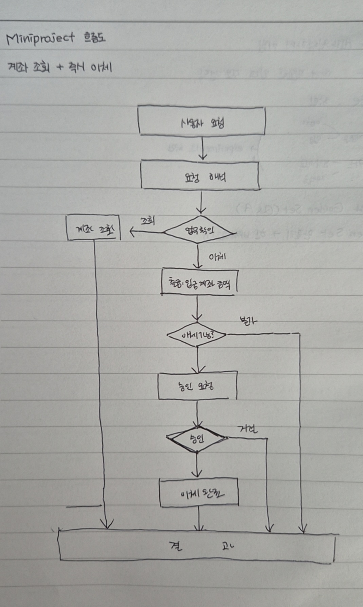
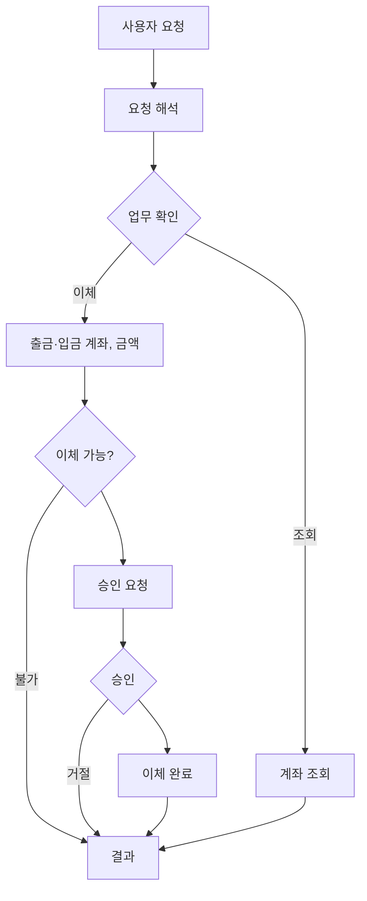

# 설계 초안: 계좌 조회 + 즉시이체

- 작성일: 2026-09-30
- 검토 전 초안입니다. 검토 후 바뀐 내용과 이유는 최종 설계 자료(`design_final.md`)에 정리합니다.

## 1. 먼저 구현할 업무

| 업무 | 구분 | 요청 예시 |
|---|---|---|
| 계좌 조회 | 조회 | "내 계좌 목록과 잔액을 보여줘." |
| 즉시이체 | 변경 (승인 필요) | "생활비에서 저축으로 10만 원 옮겨줘." |

## 2. 흐름도

손그림을 텍스트로 옮긴 버전입니다.

## 3. State 필드와 변경 시점

| 변경 시점 (단계) | State 필드 |
|---|---|
| 사용자 요청, 결과 | 대화 기록 |
| 요청 해석 | 업무 종류 |
| 계좌 조회 | 잔액, 계좌 별명, 계좌 ID, 소유자 ID |
| 출금·입금 계좌, 금액 | 출금 계좌, 입금 계좌, 금액, 잔액 |
| 승인 요청 | 사용자 결정 (승인 / 거절) |
| 이체 완료 | 거래 시각, 가맹점 등 |

## 4. 분기 조건

| 분기 지점 | 조건 | 다음 단계 | 구분 |
|---|---|---|---|
| 업무 확인 | 업무 종류가 조회 | 계좌 조회 | 조회 |
| 업무 확인 | 업무 종류가 이체 | 출금·입금 계좌, 금액 | 변경 |
| 이체 가능? | 잔액이 부족함 | 결과 | 실패 |
| 이체 가능? | 상대 계좌 ID가 잘못됨 | 결과 | 실패 |
| 이체 가능? | 위 두 경우가 아님 | 승인 요청 | 변경 진행 |
| 승인 | 사용자 결정이 승인 | 이체 완료 | 승인 |
| 승인 | 사용자 결정이 거절 | 결과 | 거절 |
