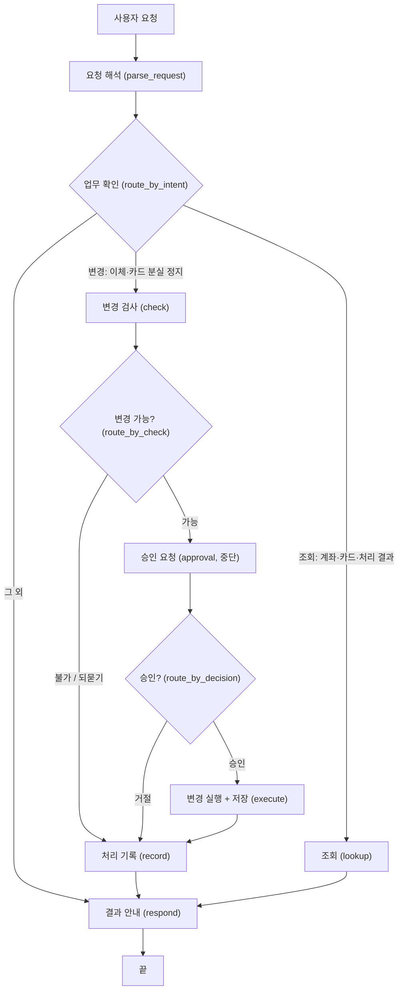

# 최종 설계: 가상 금융 에이전트

- 최종 수정: 2026-09-30
- 초안: [design_draft.md](design_draft.md) (계좌 조회 + 즉시이체)
- 구현하면서 바뀌는 내용은 이 문서에 계속 반영하고, "8. 초안에서 변경한 내용 및 이유"에 기록합니다.

## 1. 범위

| 업무 | 구분 | 요청 예시 |
|---|---|---|
| 계좌 조회 | 조회 | "내 계좌 목록과 잔액을 보여줘." |
| 즉시이체 | 변경 (승인 필요) | "생활비에서 저축으로 10만 원 옮겨줘." |
| 카드 조회 | 조회 | "내 카드 목록과 상태를 보여줘." |
| 카드 분실 정지 | 변경 (승인 필요) | "생활비 카드 잃어버렸어. 정지해줘." |
| 처리 결과 확인 (후속 결과 조회) | 조회 | "아까 이체가 됐어?" |

- 사용자는 `user-001`로 고정합니다.
- 이체는 본인 계좌끼리만 하고, 계좌는 별명(생활비, 저축, 여행 자금)으로 지정합니다.
- 카드는 이름(생활비 카드, 여행 카드)으로 지정합니다.
- "생활비", "저축", "생활비 카드"는 다른 사용자도 쓰는 이름이라, 계좌와 카드는 항상 본인 것 중에서 찾습니다.
- 카드 상태는 `active`(사용 가능), `locked`(일시 잠금), `lost`(분실 정지)입니다.

## 2. 흐름도

괄호 안은 코드의 노드 이름입니다.

## 3. State 필드와 변경 시점

| State 필드 | 코드 이름 | 담는 값 | 바뀌는 시점 |
|---|---|---|---|
| 대화 기록 | `messages` | 주고받은 메시지 | 사용자 요청, 결과 안내 |
| 업무 종류 | `intent` | 계좌 조회(`lookup`) / 카드 조회(`card_lookup`) / 처리 결과 확인(`history`) / 이체(`transfer`) / 카드 분실 정지(`card_lost`) / 그 외(`unknown`) | 요청 해석 |
| 출금 계좌 | `from_account` | 계좌 별명 (예: 생활비) | 요청 해석 |
| 입금 계좌 | `to_account` | 계좌 별명 (예: 저축) | 요청 해석 |
| 금액 | `amount` | 원 단위 정수 (예: 100000) | 요청 해석 |
| 카드 이름 | `card_name` | 카드 이름 (예: 생활비 카드) | 요청 해석 |
| 불가 이유 | `error` | 사용자에게 보여줄 불가 이유나 되묻는 질문, 없으면 빈 값 | 요청 해석(초기화), 변경 검사 |
| 사용자 결정 | `decision` | approve / reject | 요청 해석(초기화), 승인 요청(사용자가 답한 뒤) |
| 결과 | `result` | 조회 결과, 변경 결과 또는 처리 결과 확인 답변 | 요청 해석(초기화), 조회, 변경 실행 |

- 요청 해석에서 불가 이유, 사용자 결정, 결과를 초기화합니다. Checkpointer가 이전 요청의 State를 그대로 가지고 있어서, 초기화하지 않으면 이전 요청의 결과가 새 요청의 안내에 섞입니다.
- 사용자 ID(`user-001`)는 요청마다 바뀌지 않는 고정값이라 State가 아니라 함수에서 사용합니다.
- 처리 기록 단계는 State를 바꾸지 않고 JSON의 `requests`에만 기록을 추가합니다.

### 단계별 JSON 읽기·쓰기

잔액, 계좌 ID, 카드 상태, 거래 기록, 처리 기록 같은 은행 데이터는 State가 아니라 JSON 파일(`data/data.json`)에 있습니다.

| 단계 | 업무 | JSON 읽기 | JSON 쓰기 |
|---|---|---|---|
| 조회 | 계좌 조회 | `accounts`: 본인 계좌의 별명, 잔액 | 없음 |
| 조회 | 카드 조회 | `cards`: 본인 카드의 이름, ID, 종류, 상태 | 없음 |
| 조회 | 처리 결과 확인 | `requests`: 본인 처리 기록 | 없음 |
| 변경 검사 | 이체 | `accounts`: 본인 계좌 찾기, 잔액 | 없음 |
| 변경 검사 | 카드 분실 정지 | `cards`: 본인 카드 찾기, 상태 | 없음 |
| 변경 실행 + 저장 | 이체 | `accounts` | `accounts`: 두 계좌의 잔액 / `transactions`: 출금 1건, 입금 1건 추가 |
| 변경 실행 + 저장 | 카드 분실 정지 | `cards` | `cards`: 대상 카드의 상태를 `lost`로 |
| 처리 기록 | 이체, 카드 분실 정지 | 없음 | `requests`: 처리 기록 1건 추가 |

- 계좌와 카드 데이터를 바꾸는 단계는 "변경 실행 + 저장" 하나뿐이라, 거절하거나 실패하면 잔액과 카드 상태는 바뀌지 않습니다.
- 이체로 추가되는 거래 기록의 거래 시각은 실행 시각(+09:00)이고, 카드 거래가 아니므로 `card_id`와 `merchant`는 `null`입니다.
- 카드 분실 정지는 계좌 잔액과 기존 거래를 바꾸지 않습니다.

### 처리 기록(`requests`) 구조

| 필드 | 담는 값 |
|---|---|
| `request_id` | 요청 식별자 (uuid) |
| `owner_id` | 요청한 사용자 ID |
| `kind` | 업무 종류: `transfer` / `card_lost` |
| `target` | 처리 대상과 내용. 이체: 출금 계좌, 입금 계좌, 금액 / 카드 분실 정지: 카드 이름 |
| `status` | `completed`(완료) / `rejected`(사용자가 거절) / `failed`(검사에서 막힘. 되물은 경우도 진행 안 됨으로 여기에 포함) |
| `result` | 처리 결과 문장 또는 불가 이유 |
| `created_at` | 기록 시각 (+09:00) |

- 변경 요청은 결과가 완료·거절·실패 중 무엇이든 결과 안내 전에 처리 기록을 남깁니다.
- 변경 저장과 기록 저장은 따로 일어납니다. 그 사이에 프로그램이 꺼지면 변경은 반영되고 기록만 빠질 수 있습니다. 저장 장애 처리를 만들 때 함께 저장하도록 보완합니다.

## 4. 분기 조건

| 분기 지점 | 조건 | 다음 단계 | 구분 |
|---|---|---|---|
| 업무 확인 | 업무 종류가 계좌 조회, 카드 조회, 처리 결과 확인 | 조회 | 조회 |
| 업무 확인 | 업무 종류가 이체 또는 카드 분실 정지 | 변경 검사 | 변경 |
| 업무 확인 | 업무 종류가 그 외 | 결과 안내 | 실패 (처리할 수 없는 요청) |
| 변경 가능? | 불가 이유가 있음 | 처리 기록 → 결과 안내 | 실패 또는 되묻기 |
| 변경 가능? | 불가 이유가 없음 | 승인 요청 | 변경 진행 |
| 승인? | 사용자 결정이 approve | 변경 실행 + 저장 → 처리 기록 → 결과 안내 | 승인 |
| 승인? | 사용자 결정이 reject | 처리 기록 → 결과 안내 | 거절 |

변경 검사는 업무 종류에 따라 아래 두 검사 중 하나를 합니다. 위에서부터 순서대로 검사하고, 처음 걸린 조건의 문장을 불가 이유에 적습니다.

### 이체 검사 순서와 불가 이유

계좌를 찾아야 잔액을 확인할 수 있어서 이 순서로 검사합니다.

| 순서 | 불가 조건 | 불가 이유 예시 |
|---|---|---|
| 1 | 출금 계좌가 빠짐 | 어느 계좌에서 보낼까요? (생활비, 여행 자금) |
| 2 | 입금 계좌가 빠짐 | 어느 계좌로 보낼까요? (저축, 여행 자금) |
| 3 | 금액이 빠짐 | 얼마를 보낼까요? |
| 4 | 출금 계좌가 본인 계좌 중에 없음 | '○○' 계좌를 찾을 수 없습니다. (생활비, 저축, 여행 자금 중에서 골라 주세요) |
| 5 | 입금 계좌가 본인 계좌 중에 없음 | '○○' 계좌를 찾을 수 없습니다. (생활비, 저축, 여행 자금 중에서 골라 주세요) |
| 6 | 출금 계좌와 입금 계좌가 같음 | 출금 계좌와 입금 계좌가 같습니다. |
| 7 | 금액이 0 이하 | 이체 금액은 0원보다 커야 합니다. |
| 8 | 잔액이 부족함 | 잔액이 부족합니다. (현재 잔액 ○○원) |

- 1~3은 빠진 정보를 하나씩 되묻는 추가 질문입니다. 고를 수 있는 본인 계좌를 후보로 보여 주고, 이미 정해진 반대쪽 계좌는 후보에서 뺍니다.
- 사용자가 답하면 요청 해석이 같은 대화의 앞 요청과 합쳐서 다시 해석합니다. 그래서 흐름도를 바꾸지 않고, 되묻는 질문은 결과 안내로 나갑니다.

### 카드 분실 정지 검사 순서와 불가 이유

| 순서 | 불가 조건 | 불가 이유 예시 |
|---|---|---|
| 1 | 카드 이름이 빠짐 | 어느 카드를 정지할까요? (생활비 카드, 여행 카드) |
| 2 | 본인 카드 중에 없음 | '○○'에 해당하는 카드가 없습니다. (생활비 카드, 여행 카드 중에서 골라 주세요) |
| 3 | 이미 분실 정지됨 | ○○는 이미 분실 정지되어 있습니다. |

- 사용 가능(`active`)한 카드와 일시 잠금(`locked`)된 카드는 모두 분실 정지할 수 있습니다.

## 5. 승인 요청 (중단)

`interrupt()`로 그래프를 멈추고 질문(`question`)과 확인할 내용(`detail`)을 보여줍니다.

| 업무 | 질문 | 확인할 내용 |
|---|---|---|
| 이체 | 다음 이체를 승인하시겠습니까? | 생활비 → 저축 100,000원 |
| 카드 분실 정지 | 다음 카드를 분실 정지하시겠습니까? | 생활비 카드 |

- 사용자가 "승인" 또는 "거절"을 입력하면 `Command(resume={"action": "approve"})` 또는 `Command(resume={"action": "reject"})`로 재개하고, 그 값을 사용자 결정에 적습니다. 다른 답을 입력하면 다시 묻습니다.
- 재개하면 승인 요청 단계가 처음부터 다시 실행되므로, 이 단계에서는 데이터를 바꾸지 않습니다. 실제 변경은 "변경 실행 + 저장"에서만 합니다.

## 6. 결과 안내 내용

위에서부터 순서대로 확인해서 처음 해당하는 내용을 안내합니다.

| 순서 | 경우 | 판단 기준 | 안내 내용 |
|---|---|---|---|
| 1 | 그 외 | 업무 종류가 그 외 | 지금은 계좌·카드 조회, 이체, 카드 분실 정지, 처리 결과 확인만 할 수 있다는 안내 |
| 2 | 불가·되묻기 | 불가 이유가 있음 | 불가 이유 또는 되묻는 질문 |
| 3 | 거절 | 사용자 결정이 reject | 요청을 취소했고 바뀐 것은 없다는 안내 |
| 4 | 조회·변경 성공 | 위에 해당하지 않음 | 결과 (계좌 조회: 계좌별 잔액 / 카드 조회: 카드별 이름·ID·종류·상태 / 이체: 출금·입금 계좌, 금액, 이체 후 잔액 / 분실 정지: 카드 이름·ID / 처리 결과 확인: 아래 답변) |

- 처리 결과 확인은 사용자가 가리키는 요청을 대화 맥락으로 찾아야 해서, 조회 단계에서 LLM이 처리 기록만 근거로 완료·거절·실패 여부와 처리 내용을 한두 문장으로 답합니다. 결과 안내에서 LLM을 쓰는 곳은 여기 하나뿐입니다.

## 7. 업무별 정리

업무를 추가할 때마다 한 줄씩 늘립니다.

| 업무 | 분류 | 필요한 정보 | 실패 조건 | 승인 화면 | 바뀌는 데이터 |
|---|---|---|---|---|---|
| 계좌 조회 | 조회형 | 없음 | 없음 | 없음 | 없음 |
| 즉시이체 | 변경형 | 출금 계좌, 입금 계좌, 금액 | 이체 검사 1~8 | 출금·입금 계좌, 금액 | 두 계좌의 잔액, 거래 기록 2건, 처리 기록 1건 |
| 카드 조회 | 조회형 | 없음 | 없음 | 없음 | 없음 |
| 카드 분실 정지 | 변경형 | 카드 이름 | 카드 분실 정지 검사 1~3 | 카드 이름 | 대상 카드의 상태 → `lost`, 처리 기록 1건 |
| 처리 결과 확인 | 조회형 | 없음 (대화 맥락으로 대상 판단) | 없음 | 없음 | 없음 |

## 8. 초안에서 변경한 내용 및 이유

| # | 구분 | 초안 | 최종 | 이유 |
|---|---|---|---|---|
| 1 | 흐름도 | "출금·입금 계좌, 금액" 단계 | "이체 검사" 단계, 계좌와 금액은 요청 해석에서 추출 | 단계 이름은 하는 일로 적고, LLM 호출을 요청 해석 한 번으로 줄여 단순하게 하려고 |
| 2 | 흐름도 | 업무 확인: 조회 / 이체 | "그 외" 가지 추가 | 조회·이체가 아닌 요청도 처리할 수 없다고 안내하려고 (md: 실행할 수 없는 요청 안내) |
| 3 | 흐름도 | "이체 완료" | "이체 실행 + 저장" | 데이터가 바뀌는 단계를 분명히 하려고. "완료"는 결과라서 단계 이름으로 애매함 |
| 4 | 흐름도 | "결과"에서 끝남 | "결과 안내" → "끝" | 요청부터 종료까지의 흐름을 분명히 하려고 |
| 5 | 흐름도 | "승인 요청" | "승인 요청 (중단)"과 보여줄 내용 정리 | interrupt로 멈추는 단계라는 점과 승인 화면 내용을 구현 전에 정하려고 |
| 6 | State | 잔액, 계좌 ID, 소유자 ID, 거래 시각, 가맹점 등 JSON 데이터의 칸 | 단계끼리 넘기는 값만 남김 (업무 종류, 계좌, 금액, 불가 이유, 결정, 결과) | State는 단계 사이에 넘기는 값이고 은행 데이터는 JSON 파일에 있음. JSON 읽기·쓰기는 별도 표로 정리함 |
| 7 | State | 불가 이유를 담는 칸 없음 | 불가 이유(`error`) 추가 | 분기는 이 값만 보고 방향을 정하고, 결과 안내가 안 되는 이유를 말할 수 있게 하려고 |
| 8 | State | 조회 결과와 이체 결과를 따로 생각함 | 결과(`result`) 하나로 통일 | 한 번의 요청에서 둘 중 하나만 생기기 때문 |
| 9 | State | 초기화 시점 없음 | 요청 해석에서 불가 이유, 사용자 결정, 결과를 초기화 | Checkpointer가 이전 요청의 State를 유지해서, 이전 값이 새 요청에 섞이지 않게 하려고 |
| 10 | 분기 | "상대 계좌 ID가 잘못됨" | 이체 범위를 본인 계좌끼리(별명 지정)로 정하고 "입금 계좌가 본인 계좌 중에 없음"으로 바꿈 | md의 이체 예시가 모두 본인 계좌 간 이체이고 가장 단순함. 별명이 다른 사용자와 겹쳐서 본인 계좌 중에서만 찾음 |
| 11 | 분기 | 불가 조건 2개 (잔액 부족, 상대 계좌 오류) | 불가 조건 6개와 검사 순서 | md의 계좌·금액 확인, 별명 중복, "-1만 원" 예시를 반영함. 계좌를 찾아야 잔액을 볼 수 있어서 검사 순서를 정함 |
| 12 | 분기 | 정보 누락 처리 없음 | 빠진 정보(출금 계좌 → 입금 계좌 → 금액)를 하나씩 후보와 함께 되묻고, 답하면 앞 요청과 합쳐서 해석함. 계좌를 못 찾을 때도 후보를 보여 줌 | md의 추가 질문(빠진 정보를 묻고 답변을 반영, 후보가 여러 개면 선택받기)을 반영하려고 (6단계 구현) |
| 13 | 흐름도 | 이체 전용 단계 (계좌 조회, 이체 검사, 이체 실행) | 카드 조회·분실 정지를 추가하고, 단계를 업무 공통으로 바꿈 (조회, 변경 검사, 변경 실행 + 저장). 거절 안내도 공통 문장으로 바꿈 | 카드 분실 정지도 "검사 → 승인 → 실행" 모양이 같아서, 단계를 새로 만들지 않고 각 단계 안에서 업무 종류로 나눔 (7단계 구현) |
| 14 | 흐름도 | 처리 기록 없음 | 변경 요청의 결과(완료·거절·실패)를 결과 안내 전에 `requests`에 남기는 "처리 기록" 단계 추가. "아까 이체가 됐어?"는 처리 결과 확인(`history`)으로 조회 가지에서 답함 | md의 후속 결과 조회(저장된 처리 기록을 바탕으로 성공·실패·취소 여부 안내)와 `requests` 구조를 반영하려고. 가리키는 요청을 대화 맥락으로 찾아야 해서 이 답변만 LLM이 기록을 근거로 만듦 (8단계 구현) |

## 9. 다음에 확장할 것 (선택)

- 자연어 승인·승인 전 수정: "응, 진행해", "아니, 5만 원만" 같은 답을 승인·거절·수정으로 나눠 처리합니다.
- 저장 실패·재시작: 저장 오류를 안내하고, 변경과 처리 기록을 함께 저장하도록 보완합니다. 재시작 후에는 진행 중이던 업무를 안내만 하고 다시 승인받습니다.
- 카드 일시 잠금·잠금 해제 등 업무 추가: 변경 검사·실행에 업무 종류만 추가하면 됩니다.
